<div align="center">



<!-- Keep all three rotating typing messages. -->


<br />


<br />

[](https://siddhesh-b-portfolio.vercel.app/)
[](https://www.linkedin.com/in/siddheshbakre)

<p>I enjoy taking an idea from the first interface to a working, deployed product.<br />My work spans frontend engineering, backend APIs, and practical AI integrations.</p>

</div>

---

## ⚡ The developer behind the code

```ts
const siddhesh = {
  role: "Software Engineer",
  interests: ["Full-Stack", "Frontend", "AI-powered applications"],
  shipped: ["Fashion Moodboard AI", "ChatGPT Rank"],
  experience: ["Volkswagen Group Digital Solutions India", "Arkra"],
  education: "M.S. Computer Science | CSU East Bay",
  location: "San Francisco Bay Area",
  openTo: ["Software Engineer", "Full-Stack Engineer", "Frontend Engineer"],
};
```

## 🚀 Built, shipped, and ready to explore

### 👗 Fashion Moodboard AI

**From outfit photos to a personalized styling report.**

Built an authenticated full-stack experience where users upload outfit photos, Google Cloud Vision identifies visual details, and an LLM turns those details into styling recommendations. Reports and evolving style preferences are saved to each user's private history.


[](https://fashion-moodboard-ai-a955c.web.app/)
[](https://github.com/SidB-11/FashionMoodboardAI)

**Frontend:** `React` `React Router` `Vite` `GSAP` `Bootstrap` `CSS`  
**Backend & AI:** `Node.js` `Express` `Google Cloud Vision` `NVIDIA / OpenAI-compatible LLM APIs`  
**Auth & storage:** `Firebase Authentication` `Cloud Firestore` `Firebase Storage`  
**Deployment & testing:** `Docker` `Google Cloud Run` `Firebase Hosting` `Vitest` `Testing Library` `GitHub Actions`

<!-- Optional future upgrade: add a short GIF showing the real product.
<a href="https://fashion-moodboard-ai-a955c.web.app/">
  
</a>
-->

### 📈 ChatGPT Rank

**From a website URL to an actionable SEO and AI-search audit.**

Built an AI-powered audit tool that generates an eight-section report with an overall score, prioritized issues, and suggested fixes. The React frontend talks to secure serverless APIs, with Supabase PostgreSQL storing lead and usage data.


[](https://chatgpt-rank.com/)
[](https://github.com/SidB-11/ChatGPT_Rank_AISEO)

**Frontend:** `React` `Vite`  
**Backend & AI:** `Vercel Serverless Functions` `Anthropic Claude API`  
**Data & deployment:** `Supabase` `PostgreSQL` `Vercel`

### 🏢 Society Associates

**A responsive web presence for a housing society consultancy.**

Built and deployed a React website presenting services, client highlights, and an enquiry form integrated with Formspree.


[](https://www.societyassociates.in/)
[](https://github.com/SidB-11/society-associates)

**Frontend:** `React` `Vite` `CSS` `AOS (scroll animations)`  
**Forms & deployment:** `Formspree` `GitHub Pages` `GitHub Actions`


## 🧰 Tools I work with

<div align="center">


</div>

## 💼 Experience beyond personal projects

### Arkra · Frontend Engineering Intern

- Rebuilt **AutoBid's profile editor** in **React and TypeScript**, turning a modal into a full-page create/edit experience with lending rules, profile operations, and persisted form state.
- Developed **borrower, lender, and broker workflows** for loan updates, AutoPay, referrals, authorization, onboarding, and documents. Connected UI features to REST APIs and handled backend validation and asynchronous state.
- Improved frontend reliability with **Vitest and Playwright** tests for authenticated, responsive, and visual-regression flows. Addressed accessibility and SEO/prerendering issues, and used debouncing and request cancellation to prevent stale API responses in forms.

### Volkswagen Group Digital Solutions India · Software Engineer

- Started the frontend implementation of **DIMA**, a materials-related application within the MATTER team, converting **20+ customer-approved Figma screens** into Angular interfaces with TypeScript, HTML, CSS, and Volkswagen's GroupUI library.
- Implemented reusable UI components, layouts, and screen interactions to bring the approved designs into a consistent, working frontend.

## 🤝 Let's build something useful

I'm exploring full-time **software engineering, full-stack, and frontend** opportunities. If a project caught your eye, take a look at the live version or source code, and feel free to connect.

<div align="center">

[](https://siddhesh-b-portfolio.vercel.app/)
[](https://www.linkedin.com/in/siddheshbakre)


</div>